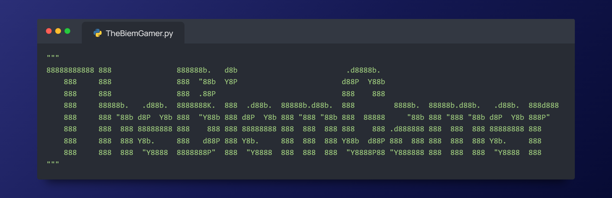

  

  <h1>Noah</h1>

  
Developer who enjoys building things, from web apps to low-level game tools.

  

    &nbsp;ICT student at <a href="https://www.internationalhu.com">HU University of Applied Sciences Utrecht</a>
    &nbsp;&nbsp;·&nbsp;&nbsp;
    &nbsp;The Netherlands
  

 

<h3>&nbsp; Tech stack</h3>

 

<h3>&nbsp; Featured projects</h3>

| Project | Description | Stack |
| :--- | :--- | :--- |
| [**GiantsRecomp**](https://github.com/TheBiemGamer/GiantsRecomp) | Unofficial PC port of Skylanders Giants (Xbox 360), statically recompiled with ReXGlue. Supports virtual and real USB Portal of Power, ultrawide and more. |  |
| [**skylanders-portal**](https://github.com/TheBiemGamer/skylanders-portal) | Skylanders Portal of Power emulation for ReXGlue Xbox 360 recompilations. |  |
| [**Proteus**](https://github.com/TheBiemGamer/Proteus) | Universal mod manager for PC games. |   |
| [**LaunchHDR**](https://github.com/TheBiemGamer/LaunchHDR) | Turns HDR on when a game launches and off when it closes. |  |

 

<h3>&nbsp; Earlier work</h3>

| Project | Description | Links |
| :--- | :--- | :--- |
| [The Hangman Wordlist](https://thebiemgamer.github.io/The-Hangman-Wordlist/) | Python module that returns hangman words. |  |
| [JSON File Helper](https://thebiemgamer.github.io/Json-File-Helper/) | Helper class for reading and writing JSON files in Python. |  |
| [WhoIs API](https://github.com/TheBiemGamer/WhoIsApi) | WhoIs lookup API with a web frontend. |  |

 

&nbsp; Fun fact: it is <a href="https://www.wired.com/story/physics-explains-why-you-cant-open-a-plane-door-mid-flight/">nearly impossible to open an airplane door at cruising altitude</a>, because of the difference in air pressure.
